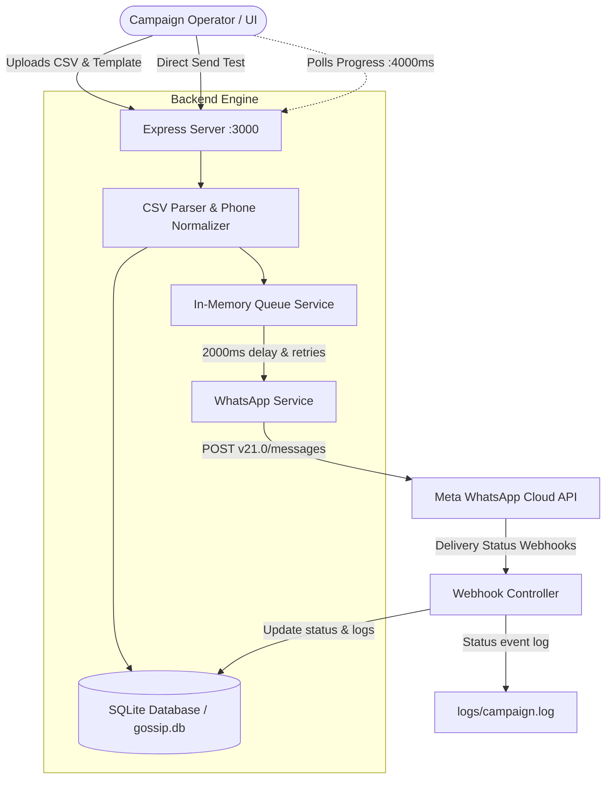

# Gossip — System Architecture & Technical Documentation

This document serves as the complete technical specification and architectural manual for **Gossip**, an automated bulk messaging and campaign management platform built for Meta's **WhatsApp Cloud API (v21.0)**.

---

## 1. High-Level Architecture

Gossip connects business campaign operators with Meta's WhatsApp Cloud infrastructure via an asynchronous, rate-limited processing engine backed by SQLite persistence.



---

## 2. Directory Structure & Key Files

```text
gossip/
├── src/
│   ├── config/
│   │   └── db.js                      # SQLite database connection & foreign key pragma
│   ├── controllers/
│   │   ├── campaignController.js      # Campaign creation, status retrieval & listing
│   │   ├── sendTestController.js      # Instant test message trigger
│   │   └── webhook.controller.js      # Meta webhook handshake & status event listener
│   ├── middleware/
│   │   └── upload.js                  # Multer disk upload config for CSV files
│   ├── routes/
│   │   ├── campaign.js                # /campaign router
│   │   ├── sendTest.js                # /send-test router
│   │   └── webhook.routes.js          # /webhook router
│   ├── services/
│   │   ├── campaignService.js         # Campaign database CRUD & metric increments
│   │   ├── dbService.js               # Database schema initialization & helpers
│   │   ├── logService.js              # Append-only file logger for logs/campaign.log
│   │   ├── messageService.js          # Formatter for template & body components
│   │   ├── messageTrackingService.js  # Correlates Meta wamid to campaigns & status
│   │   ├── queueService.js            # Sequential FIFO queue with pacing & retries
│   │   └── whatsappService.js         # Meta Graph API HTTP client (POST /messages)
│   ├── utils/
│   │   ├── csv.parser.js              # Robust CSV parsing (header/headerless, params)
│   │   ├── phone.js                   # E.164-compatible digit normalizer (10-15 digits)
│   │   └── time.js                    # Promisified sleep delay helper
│   ├── app.js                         # Express middleware, CORS, routing & static fallback
│   └── server.js                      # Server entry point, env verification & DB bootstrap
├── frontend/
│   ├── src/
│   │   ├── App.jsx                    # Operator console (Campaigns, New, Test, Monitor)
│   │   ├── config.js                  # Backend API URL config
│   │   ├── main.jsx                   # React root entry
│   │   └── styles.css                 # Application styling
│   ├── index.html                     # HTML shell
│   └── vite.config.js                 # Vite build & dev config
├── data/
│   └── gossip.db                      # SQLite relational database
├── logs/
│   └── campaign.log                   # NDJSON log entries for all message events
├── uploads/                           # Ingested CSV files
├── .env.example                       # Reference environment variables
└── README.md                          # Quickstart guide
```

---

## 3. Database Schema (`data/gossip.db`)

Managed via `better-sqlite3` in [src/services/dbService.js](file:///Users/shubham.shukla/Documents/gossip/src/services/dbService.js).

### `campaigns`
Stores campaign metadata and real-time aggregate delivery counters.
| Column | Type | Description |
|---|---|---|
| `id` | `TEXT PRIMARY KEY` | UUIDv4 string |
| `template_name` | `TEXT` | WhatsApp registered template name |
| `status` | `TEXT` | `processing` or `completed` |
| `total` | `INTEGER` | Total rows identified in CSV |
| `queued` | `INTEGER DEFAULT 0` | Valid rows queued for dispatch |
| `sent` | `INTEGER DEFAULT 0` | Messages successfully accepted by Meta |
| `delivered` | `INTEGER DEFAULT 0` | Messages confirmed delivered or read via webhook |
| `failed` | `INTEGER DEFAULT 0` | Invalid numbers or API send failures |
| `created_at` | `DATETIME DEFAULT CURRENT_TIMESTAMP` | Creation timestamp |

### `messages`
Tracks individual messages dispatched by the system.
| Column | Type | Description |
|---|---|---|
| `id` | `TEXT PRIMARY KEY` | Meta WhatsApp message ID (`wamid.<id>`) |
| `campaign_id` | `TEXT` | Foreign key referencing `campaigns(id)` |
| `phone` | `TEXT` | Normalized recipient phone number |
| `status` | `TEXT` | Current status (`sent`, `delivered`, `read`, `failed`) |
| `retry_count` | `INTEGER DEFAULT 0` | Number of retries attempted before delivery |
| `created_at` | `DATETIME DEFAULT CURRENT_TIMESTAMP` | Dispatch timestamp |

### `message_status_events`
Audit trail of every raw status callback received from Meta webhooks.
| Column | Type | Description |
|---|---|---|
| `id` | `INTEGER PRIMARY KEY AUTOINCREMENT` | Event sequence ID |
| `message_id` | `TEXT` | Foreign key referencing `messages(id)` |
| `status` | `TEXT` | Status received from webhook (`sent`, `delivered`, `read`, `failed`) |
| `recipient_id` | `TEXT` | Recipient WhatsApp phone number |
| `raw_payload` | `TEXT` | Full JSON serialized webhook event object |
| `created_at` | `DATETIME DEFAULT CURRENT_TIMESTAMP` | Ingestion timestamp |

---

## 4. Message Processing Pipeline

### 1. Ingestion & Validation
- **Upload**: `POST /campaign` receives a CSV file via `multer`.
- **Parsing**: `parseCampaignCsvFile` handles both header-bearing (`phone,param1,param2...`) and headerless CSV files.
- **Normalization**: `normalizePhoneNumber` strips `+`, whitespace, dashes, and letters. Valid numbers must contain between 10 and 15 digits.
- **Immediate Failure Handling**: Rows with invalid numbers are immediately recorded as `failed` in the campaign record and logged to `logs/campaign.log`.

### 2. Sequential Queue Execution
- Valid rows are pushed into the in-memory queue managed by `queueService.js`.
- An asynchronous worker processes items sequentially:
  - **Pacing**: Delays 2,000ms (`MESSAGE_DELAY_MS`) between messages to comply with Meta tier rate limits.
  - **Retries**: If Meta returns an error, the message is re-queued with an incremented attempt counter (up to 2 retries).
  - **Tracking Registration**: Once Meta returns HTTP 200 with a message ID (`wamid`), it is registered in SQLite under `messages` with status `'sent'`.

### 3. Webhook Feedback Loop
- **Verification (`GET /webhook`)**: Validates Meta's challenge handshake using `WEBHOOK_VERIFY_TOKEN`.
- **Event Handling (`POST /webhook`)**:
  - Immediately returns HTTP 200 to acknowledge Meta.
  - Spawns background worker via `setImmediate()` to parse `entry[0].changes[0].value.statuses`.
  - Appends to `message_status_events`.
  - Updates `messages.status`.
  - Updates `campaigns.delivered` or `campaigns.failed`.
  - Automatically marks campaign as `completed` when `delivered + failed >= total`.

---

## 5. API Reference

### `POST /campaign`
Uploads a CSV and launches a bulk campaign.
- **Content-Type**: `multipart/form-data`
- **Fields**:
  - `file`: CSV file containing phone and dynamic parameters.
  - `templateName`: (Required) Meta-approved template identifier.
  - `languageCode`: (Optional) Template language, default `en_US`.
- **Response** (HTTP 202):
  ```json
  {
    "campaignId": "9e9eb8f7-43c8-4719-8a8d-beb182c71017",
    "status": "started"
  }
  ```

### `GET /campaign`
Returns all campaigns ordered by creation date descending.
- **Response** (HTTP 200):
  ```json
  {
    "success": true,
    "data": [
      {
        "id": "9e9eb8f7-43c8-4719-8a8d-beb182c71017",
        "templateName": "seminar_feedback",
        "total": 50,
        "queued": 48,
        "sent": 48,
        "delivered": 45,
        "failed": 5,
        "status": "completed",
        "createdAt": "2026-10-31 20:30:00"
      }
    ]
  }
  ```

### `GET /campaign/:id`
Retrieves live status metrics for an individual campaign.
- **Response** (HTTP 200):
  ```json
  {
    "success": true,
    "data": {
      "id": "9e9eb8f7-43c8-4719-8a8d-beb182c71017",
      "templateName": "seminar_feedback",
      "total": 50,
      "queued": 48,
      "sent": 48,
      "delivered": 45,
      "failed": 5,
      "status": "completed"
    }
  }
  ```

### `POST /send-test`
Dispatches a single template or text message immediately for validation.
- **Content-Type**: `application/json`
- **Body**:
  ```json
  {
    "to": "919580174041",
    "type": "template",
    "templateName": "seminar_feedback",
    "languageCode": "en_US",
    "components": [
      {
        "type": "body",
        "parameters": [
          { "type": "text", "text": "Shubham" },
          { "type": "text", "text": "Annual Conference" }
        ]
      }
    ]
  }
  ```

### `GET /webhook` & `POST /webhook`
- `GET`: Handles Meta Webhook verification using query params `hub.mode`, `hub.verify_token`, and `hub.challenge`.
- `POST`: Ingests both outbound delivery callbacks (`sent`, `delivered`, `read`, `failed`) and inbound user messages. When an inbound message is received from a QR scan or direct message, it captures the user's phone, WhatsApp profile name, and trigger text, appending them directly to `data/leads.csv` and the SQLite `leads` table.

### `GET /leads`
Returns the JSON array of all captured leads.

### `GET /leads/google-sheet` & `POST /leads/google-sheet`
- `GET`: Returns the active Google Sheet Webhook URL.
- `POST`: Updates the Google Sheet Webhook URL in `data/settings.json`.

### `POST /leads/test-google-sheet`
Dispatches a test connection ping row directly to the configured Google Sheet.

### `GET /leads/export`
Streams `data/leads.csv` with Excel-compatible UTF-8 BOM encoding for direct download as a backup spreadsheet (`whatsapp_leads.csv`).

---

## 6. Environment Configuration

Defined in `.env`:
```ini
PORT=3000
WHATSAPP_ACCESS_TOKEN=your_meta_system_user_token
PHONE_NUMBER_ID=your_meta_phone_number_id
WEBHOOK_VERIFY_TOKEN=your_secret_verification_string
CORS_ALLOWED_ORIGINS=https://your-frontend.vercel.app,http://localhost:5173
GOOGLE_SHEET_WEBHOOK_URL=https://script.google.com/macros/s/your_apps_script_id/exec
```

